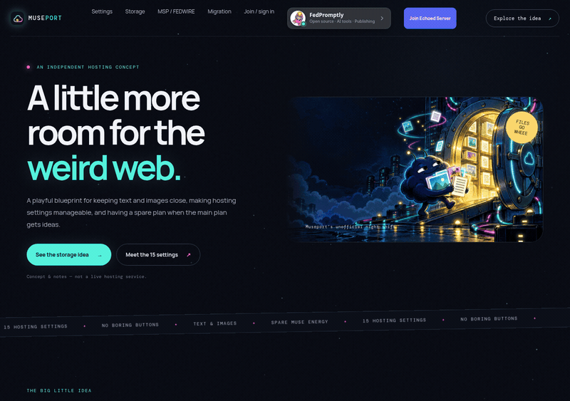
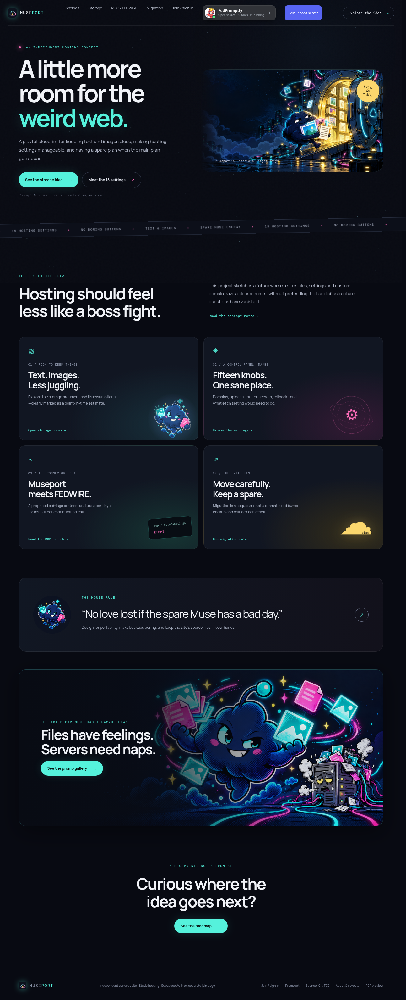
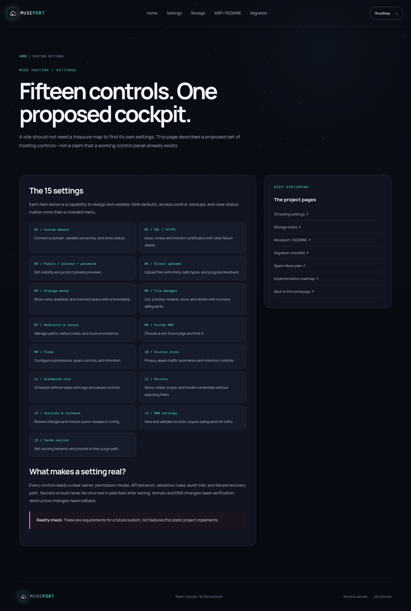
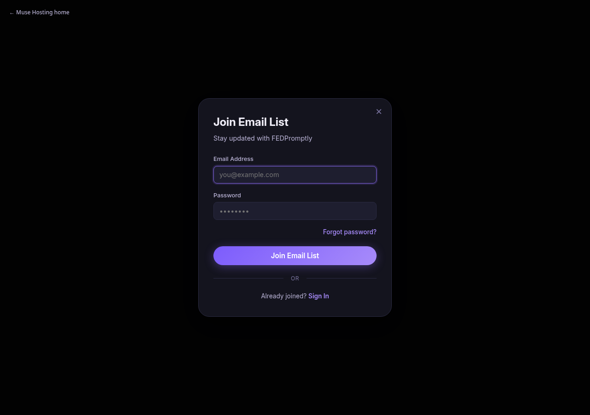
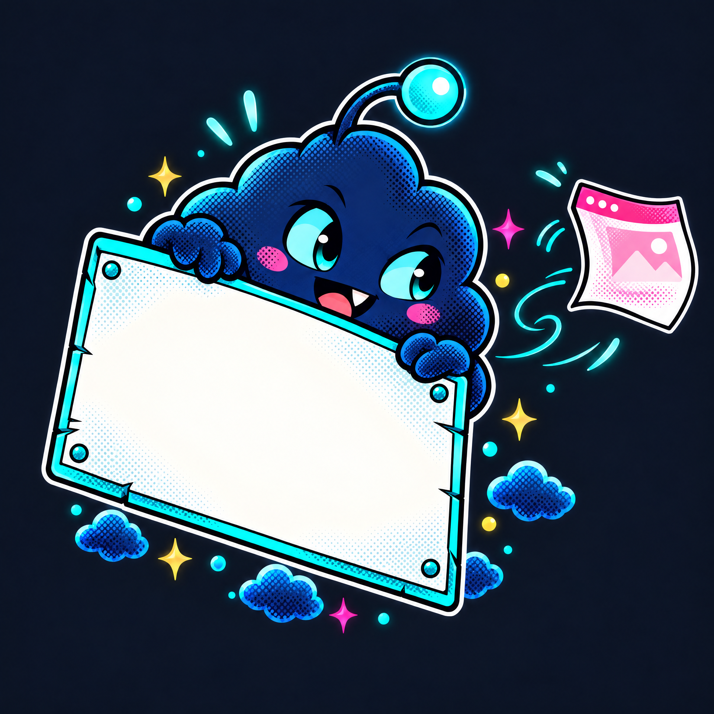

# Muse Hosting


**A dark, playful static concept site exploring how portable hosting, settings, and safer migrations could feel.**

  

> This repository is a concept site and documentation bundle—not a hosting platform. The 15 hosting controls, Museport (MSP), and FEDWIRE are proposals, not working infrastructure.

## Why this exists

Hosting discussions get confusing when storage capacity, public access, security, backups, and deployment are treated as if they were the same thing. This project makes one hosting vision easier to inspect: a proposed set of 15 site settings, a Museport configuration protocol sketch, and a cautious path for evaluating a spare host or future migration.

It is intentionally a **static, inspectable starting point**. There is no build system or framework to install, and the pages label proposed capabilities instead of presenting them as finished features. Storage numbers in the original notes are dated, unverified claims; check current first-party sources before relying on them.

## See it work

**Live demo: unavailable.** There is no public deployment URL configured or claimed in this repository. The fastest real demo is to serve the files locally:

```bash
python3 -m http.server 8000
```

Open <http://localhost:8000> to view the actual site. The animated GIF below is a short browser capture of this local project—not a mockup or hosted demo.



The main entry point is [`index.html`](index.html). For the proposal itself, start with the [15 hosting settings](settings.html) or the [MSP / FEDWIRE protocol sketch](protocol.html). The [example Muse AI page](examples/museai-page.md) and [fedpromptly.com move checklist](examples/fedpromptly-move-checklist.md) are planning examples, not runnable backend integrations.

## Screenshots

These screenshots were captured from the local HTML pages in a browser. They show the real static site; no data was submitted to the signup form during capture.

| Page | Preview |
|---|---|
| Home — animated dark landing page and original comic hero art |  |
| Settings — the proposed 15-control list, explicitly marked as a concept |  |
| Join dialog — supplied FEDPromptly Supabase Auth interface, opened without submitting credentials |  |
| Community invite — FedPromptly modal opened from the homepage |  |

## Original promo artwork

A small comic cast for the site: an archive-hauling cloud, a wheezing server, a backup drive, and a curious 404 gremlin. The images are also collected on the [Promo Art page](promos.html).





The site also includes a symbolic SVG favicon, animated CSS starfield, reduced-motion support, and the actual browser-tour GIF above.

## Quick start

Requirements: Python 3 (or any static file server) and a browser. There is **nothing to install** and no package manager or build command.

```bash
# Run from the repository root
python3 -m http.server 8000

# In another terminal, check HTML local links/assets and JSON configs
python3 scripts/check_site.py
```

Then open <http://localhost:8000>. Stop the server with `Ctrl+C`.

## What is included

- **Static pages:** home, settings, storage, MSP/FEDWIRE, migration, roadmap, spare-Muse, sponsor, promo gallery, about, and 404 pages.
- **Hosting proposal:** 15 illustrative controls covering domains, HTTPS, visibility, uploads, storage, files, routes, 404s, forms, analytics, scheduled runs, secrets, rollback, DNS, and cache.
- **Protocol notes:** Museport (MSP) and FEDWIRE proposal documents plus an illustrative JSON configuration schema.
- **Visual identity:** symbolic SVG favicon (not a letter), CSS starfield animation, original comic-style promotional art, reduced-motion support, and a real browser-tour GIF.
- **Deployment files:** GitHub Pages Actions workflow, Cloudflare Pages configuration, Cloudflare Workers Static Assets configuration, and Pages-compatible `_headers` / `_redirects` examples.
- **Community links:** the FEDPromptly invite button sits beside join/sign-in and opens an accessible dialog. A separate Echoed Server button points to the supplied invite URL. Both open external pages in a new tab.
- **FEDPromptly join page:** [`join.html`](join.html) uses the Supabase Auth client and project URL/publishable key supplied in the provided snippet. The form creates or signs into an Auth account; it does **not** by itself save a newsletter subscription to a mailing list. Confirm Supabase allowed redirect URLs, email settings, and policies before using it publicly. Never put a service-role key in static client code.

## Deployment status and options

No deployment has been performed and no live URL is configured. The files provide starting configurations; verify the selected platform's current requirements and published routes after deploying.

**GitHub Pages:** [`.github/workflows/pages.yml`](.github/workflows/pages.yml) publishes the repository root through GitHub Actions. Enable Pages for the repository with GitHub Actions as the source, then verify the workflow run and resulting site. This configuration is not evidence that a deployment has already succeeded.

**Cloudflare Pages:** [`wrangler.jsonc`](wrangler.jsonc) sets the Pages output directory to the repository root, with no build command required. Connect the repository to Pages or use Wrangler. `_headers` and `_redirects` are included as Pages-compatible static behavior files. See Cloudflare's [Pages Wrangler configuration guide](https://developers.cloudflare.com/pages/functions/wrangler-configuration/).

**Cloudflare Workers Static Assets:** [`wrangler.worker.jsonc`](wrangler.worker.jsonc) points Workers Static Assets at the repository root and maps unknown paths to `404.html`. After installing or invoking Wrangler and authenticating with Cloudflare, deploy with `npx wrangler deploy --config wrangler.worker.jsonc`. Because the asset directory is the repository root, this publishes the project's static files—including documentation—to the Worker. Do not place secrets in this repository. See Cloudflare's [Workers Static Assets guide](https://developers.cloudflare.com/workers/static-assets/).

**Custom domain:** no domain is configured. Set DNS and HTTPS only after selecting a hosting target and testing the published pages.

The site is static except for the separate join form's Supabase Auth calls. It does not implement Muse hosting, file uploads, a settings API, MSP/FEDWIRE transport, domain management, newsletter-list storage, visitor analytics, or the storage service discussed in the concept notes. Provider/storage figures from the source conversation are not current verified measurements.

## Explore the repository

- [Home](index.html) · [Hosting settings](settings.html) · [Storage notes](storage.html)
- [MSP / FEDWIRE](protocol.html) · [Migration notes](migration.html) · [Roadmap](roadmap.html)
- [Promo art](promos.html) · [GitHub Sponsors card](sponsor.html) · [FEDPromptly join page](join.html) · [Join Echoed Server](https://preview.echoed.gg/server/65dd48216ed48ac1856e)
- [About and caveats](about.html) · [Project file tree](muse-hosting-file-tree.md)
- [Documentation](docs/) · [Illustrative config](msp/config-schema.json)

## Names and proposal chain

**Muse Hosting** is the project concept. **Museport (MSP)** is the proposed Muse Settings Protocol, and **FEDWIRE** is the proposed transport layer. The sketched chain is: operator → Muse AI → MSP connector → FEDWIRE → site configuration API. Nothing in this repository implements that chain.

## Contributing and license

The repository currently has no `CONTRIBUTING.md` or `LICENSE` file. Check with the project owner before reusing or redistributing the original artwork or other project content; no license is implied by the absence of a file.
